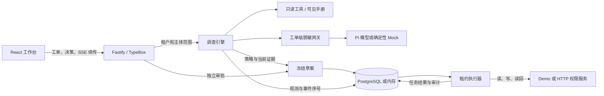
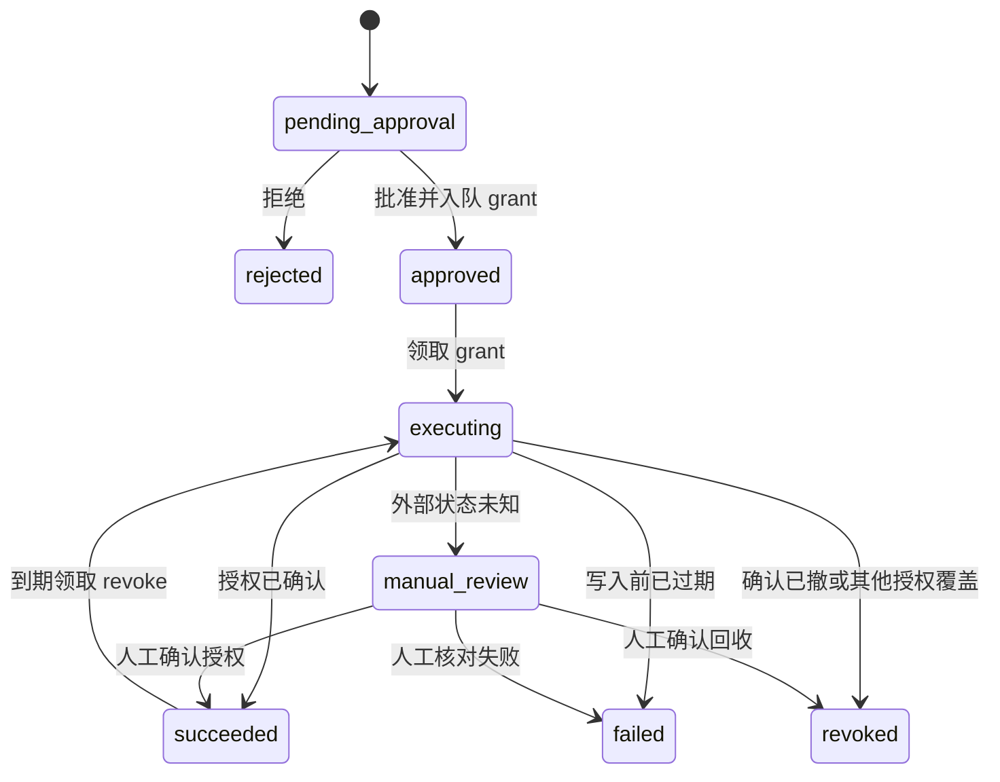
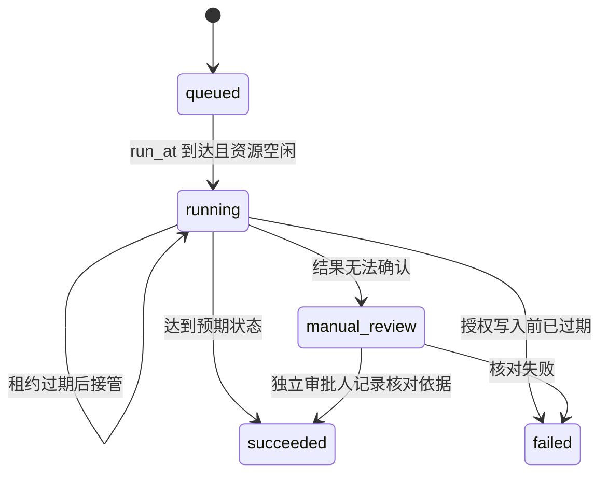

# ServiceDesk 的调查与授权执行

## 变更与任务

有效期从起草时计算，绝对截止时间参与哈希。批准和 grant 入队同事务提交。限时授权确认及 revoke 入队也同事务提交。每个变更、任务类型至多一条任务。锁粒度为租户、应用、受益人，回收再按角色检查其他有效授权。同一资源的人工核对会阻塞后续任务。

外部 HTTP 写入无法加入数据库事务。资源锁、租约、版本条件更新保护任务状态，接管者先读外部权限，再决定是否写入。测试在权限服务完成写入但尚未应答时终止 worker，验证第二个 worker 可接管且只有一次授权写入。

每个部署运行单个 API 进程，工单调查在进程内排队。SSE 通过数据库中的单调序号重放。演示会话和故障开关只保存在本地适配器进程内，重启复位。

## 排错与迭代记录

- **推理参数在网关丢失**。早期账本标记了 high，但脱敏转发层漏传 reasoning。修复后使用本地 HTTP 捕获两种协议的实际请求体。旧账本保留原有勘误。
- **审批后仍引用旧角色清单**。执行完成会改变权限观测的有效性。调查与详情接口共用时效判断；审批或回收后的复查重新读取会话与角色清单，保留旧证据 ID 供审计。
- **起草工具传入 viewer 简称**。服务端策略要求完整角色名，首轮五项任务有四项触发拒绝。收紧模型工具参数为完整角色值后重跑，保留服务端独立校验。
- **原始观测拆分与重复验证**。将目录、会话、角色库存、服务事件分开采集。模型通过请求标识及事件时间关联故障与日志。五条独立工作流重复三轮，15 次全部通过，五条均达到 pass^3。样本和模型配置见[评测报告](model-eval-report.md)。
