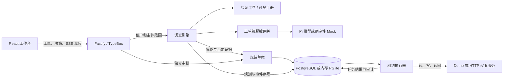
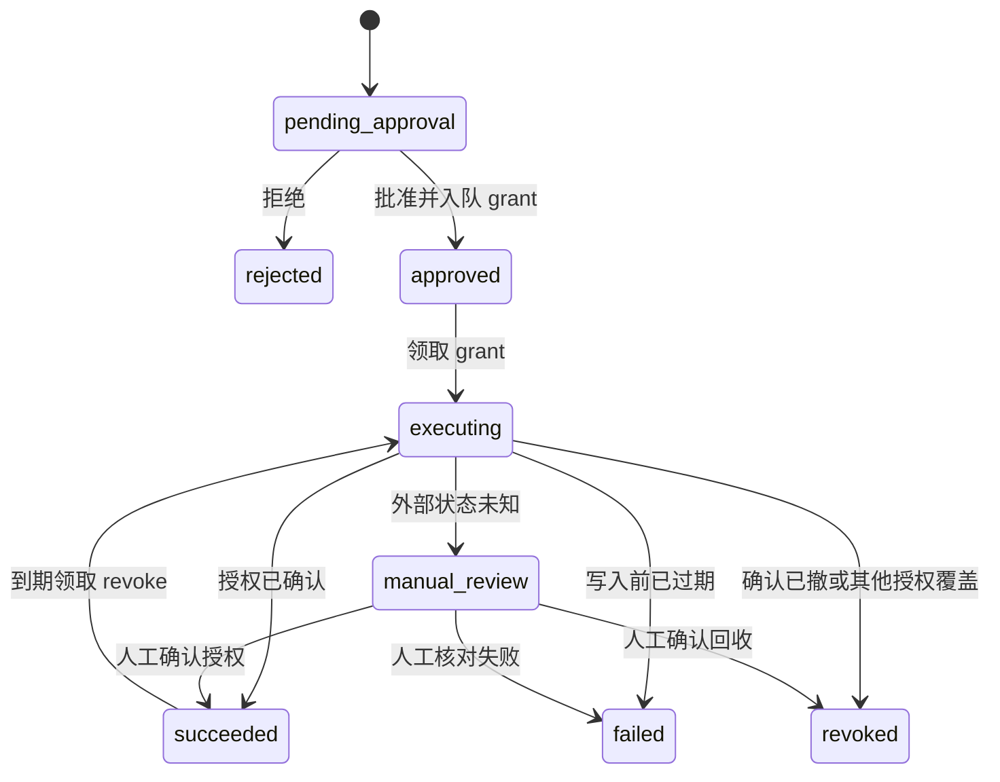
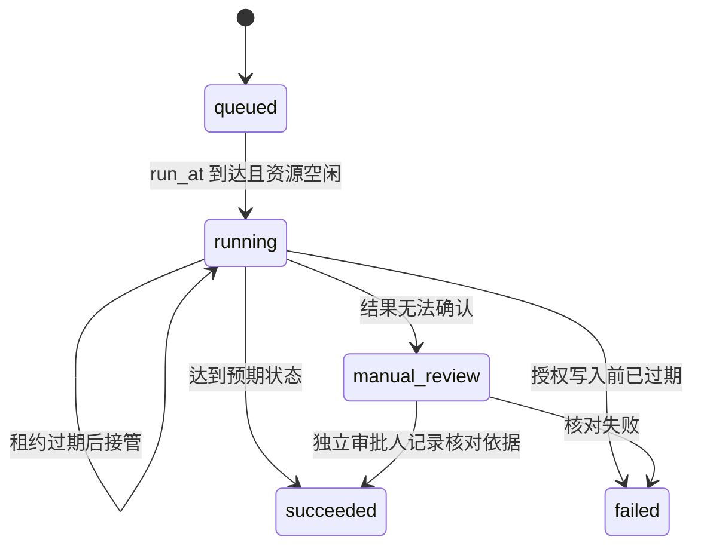

# ServiceDesk 的调查与授权执行

## 变更与任务

有效期从起草时计算，绝对截止时间参与哈希。批准和 grant 入队同事务提交。限时授权确认及 revoke 入队也同事务提交。每个变更、任务类型至多一条任务。锁粒度为租户、应用、受益人，回收再按角色检查其他有效授权。同一资源的人工核对会阻塞后续任务。

外部 HTTP 写入无法加入数据库事务。资源锁、租约、版本条件更新保护任务状态，接管者先读外部权限，再决定是否写入。测试在权限服务完成写入但尚未应答时终止 worker，验证第二个 worker 可接管且只有一次授权写入。

共享 PostgreSQL 和密钥的 API 实例可在负载均衡器后运行，并搭配独立 Worker。运行通知只携带类型和 runId，任一实例均可按序号续传 SSE，无需会话亲和。同工单的新调查在活跃租约期间返回 409，租约过期后可接管。演示桌面会话与变更时间随工单保存，故障开关在进程重启后复位。

PostgreSQL API 保留专用连接执行 `LISTEN desk_events`。审批决定、人工结案和执行器终态提交后，发布者通过 `pg_notify` 发送租户 ID、事件类型、变更 ID 和唤醒标志。API 按租户转发到本地 SSE，并按标志唤醒执行器。数据库保存业务状态，通知用于提示刷新。服务关闭时取消监听并释放连接。PGlite 直接使用进程内事件总线。

PGlite 与 PostgreSQL 使用相同 SQL 迁移。TenantScope 从已认证身份绑定租户，对子记录按父表验证归属，并在事务内通过 set_config 设置局部 app.tenant_id。Bearer Token 由 MASK_KEY 做 HMAC-SHA256 签名，签名和有效期校验通过后使用其中的身份；ALLOW_DEMO_AUTH=0 可禁用演示头。

InvestigationSource 提供四类只读观测。权限成功或回收的时间使更早的权限与会话观测过期，桌面会话切换只使更早的会话观测过期。引擎在模型调用前补采过期来源，详情接口使用相同判定。目录、手册和服务事件保留历史证据。

Pino 按 traceparent 关联请求完成状态；审批追踪头随任务持久化，授权、回收和读回请求沿用该值。GET /api/metrics 返回当前进程按租户累计的调查、工具、Token 和执行器终态计数。

## 排错与迭代记录

- **推理参数在网关丢失**。早期账本标记了 high，但脱敏转发层漏传 reasoning。修复后使用本地 HTTP 捕获两种协议的实际请求体。旧账本保留原有勘误。
- **审批后仍引用旧角色清单**。执行完成会改变权限观测的有效性。调查与详情接口共用时效判断；审批或回收后的复查重新读取会话与角色清单，保留旧证据 ID 供审计。
- **起草工具传入 viewer 简称**。服务端策略要求完整角色名，首轮五项任务有四项触发拒绝。收紧模型工具参数为完整角色值后重跑，保留服务端独立校验。
- **原始观测拆分与重复验证**。将目录、会话、角色库存、服务事件分开采集。模型通过请求标识及事件时间关联故障与日志。五条独立工作流重复三轮，15 次全部通过，五条均达到 pass^3。样本和模型配置见[评测报告](model-eval-report.md)。

## 刻意保留的边界

- 外部管理员旁路修改权限时，本地终态水位线无法感知变动。企业部署可增加外部漂移巡检与对账。
- 当前租户隔离由应用作用域和父记录约束执行。按数据库角色强制执行的多角色 PostgreSQL RLS 留作企业部署扩展。
- 当前部署使用单版本密钥。多版本密钥轮换、历史数据重加密与旧版本退役留作企业部署扩展。
