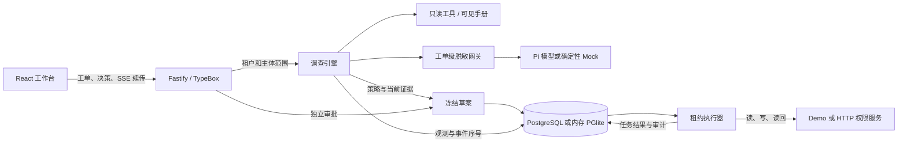
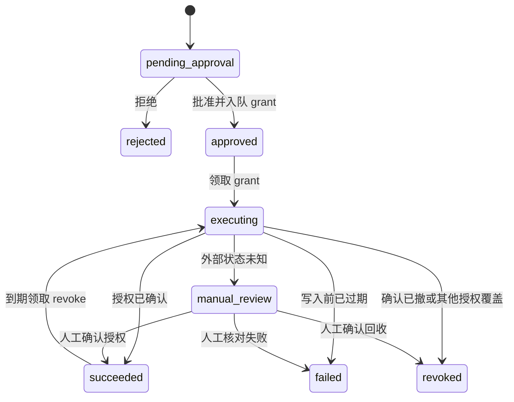
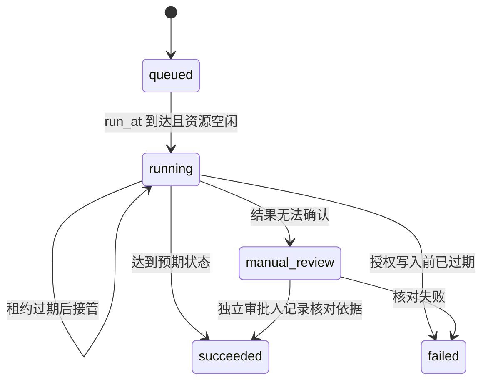

# ServiceDesk 的调查与授权执行

## Pi 调查循环

Pi 0.73.1 并行执行同一轮的只读工具。含有 `draft_access_change` 的整批调用按模型顺序串行执行。Pi 校验工具 schema 后，前置钩子检查取消、工单引用与起草证据。后置钩子统一处理执行错误，尝试与失败次数按开始、结束事件统计。每轮调查最多向模型发送十次请求。工单 UUID 用作缓存会话标识，每次请求按调查剩余时间限制超时和重试等待。

同一调查内的 Vault 按队列分配引用。事件事务先锁定 run 行再分配序号，PGlite 使用单连接事务队列。工作台通过原有 SSE 游标回放工具状态和回复快照。思考事件只有阶段标识。回复预览最多每 250 毫秒检查一次，仅发布已脱敏且有安全句界的前缀，遇到凭据上下文保留后续内容至最终脱敏。网关在转发模型上下文及回调修改后的请求体前校验隐私。

## 变更与任务

有效期从起草时计算，绝对截止时间参与哈希。批准和 grant 入队同事务提交。限时授权确认及 revoke 入队也同事务提交。每个变更、任务类型至多一条任务。锁粒度为租户、应用、受益人，回收再按角色检查其他有效授权。同一资源的人工核对会阻塞后续任务。

外部 HTTP 写入无法加入数据库事务。资源锁、租约、版本条件更新保护任务状态，接管者先读外部权限，再决定是否写入。测试在权限服务完成写入但尚未应答时终止 worker，验证第二个 worker 可接管且只有一次授权写入。

共享 PostgreSQL 和密钥的 API 实例可在负载均衡器后运行，并搭配独立 Worker。运行通知只携带类型和 runId，任一实例均可按序号续传 SSE，无需会话亲和。同工单的新调查在活跃租约期间返回 409，租约过期后可接管。演示桌面会话与变更时间随工单保存，故障开关在进程重启后复位。

PostgreSQL API 保留专用连接执行 `LISTEN desk_events`。审批决定、人工结案和执行器终态提交后，发布者通过 `pg_notify` 发送租户 ID、事件类型、变更 ID 和唤醒标志。API 按租户转发到本地 SSE，并按标志唤醒执行器。数据库保存业务状态，通知用于提示刷新。服务关闭时取消监听并释放连接。PGlite 直接使用进程内事件总线。

PGlite 与 PostgreSQL 使用相同 SQL 迁移。TenantScope 从已认证身份绑定租户，对子记录按父表验证归属，并在事务内通过 set_config 设置局部 app.tenant_id。Bearer Token 由 MASK_KEY 做 HMAC-SHA256 签名，签名和有效期校验通过后使用其中的身份；ALLOW_DEMO_AUTH=0 可禁用演示头。

InvestigationSource 提供四类只读观测。权限成功或回收的时间使更早的权限与会话观测过期，桌面会话切换只使更早的会话观测过期。引擎在模型调用前补采过期来源，详情接口使用相同判定。目录、手册和服务事件保留历史证据。

Pino 按 traceparent 关联请求完成状态；审批追踪头随任务持久化，授权、回收和读回请求沿用该值。GET /api/metrics 返回当前进程按租户累计的调查、工具、Token 和执行器终态计数。

## 安全基座与模型传输

`resource_watermarks` 按租户、工单和主题记录最新变更时间。授权成功或回收时推进 `access_state`，切换桌面会话时推进 `session_state`，均与业务状态在同一事务提交。证据来源通过 `invalidatedBy` 声明订阅主题，观测时间早于任一订阅水位线即过期。

`Vault.open` 接受附加检测器和字段类型。规则检测、内置字段类型与敏感键过滤始终生效，扩展检测器同时参与出站检查。

`src/model/transport.ts` 根据 `MODEL_PROVIDER` 和 `MODEL_ID` 解析 Pi 内置模型，保留自定义端点配置，收敛思考档位并统计模型用量。租户指标 `cache_read_tokens`、`cache_write_tokens` 和 `cost_usd` 分别累计缓存读写 token 与美元费用。

## 排错与迭代记录

- **推理参数在网关丢失**。早期账本标记了 high，但脱敏转发层漏传 reasoning。修复后使用本地 HTTP 捕获两种协议的实际请求体。旧账本保留原有勘误。
- **审批后仍引用旧角色清单**。执行完成会改变权限观测的有效性。调查与详情接口共用时效判断；审批或回收后的复查重新读取会话与角色清单，保留旧证据 ID 供审计。
- **起草工具传入 viewer 简称**。服务端策略要求完整角色名，首轮五项任务有四项触发拒绝。收紧模型工具参数为完整角色值后重跑，保留服务端独立校验。
- **原始观测拆分与重复验证**。将目录、会话、角色库存、服务事件分开采集。模型通过请求标识及事件时间关联故障与日志。五条独立工作流重复三轮，15 次全部通过，五条均达到 pass^3。样本和模型配置见[评测报告](model-eval-report.md)。

## 刻意保留的边界

- 外部管理员旁路修改权限时，本地终态水位线无法感知变动。企业部署可增加外部漂移巡检与对账。
- 当前租户隔离由应用作用域和父记录约束执行。按数据库角色强制执行的多角色 PostgreSQL RLS 留作企业部署扩展。
- 当前部署使用单版本密钥。多版本密钥轮换、历史数据重加密与旧版本退役留作企业部署扩展。

## DP3 可续跑调度核

调查层负责装配工具、授权和提示词。通用调度核使用 Pi 的无状态循环，以结构化时间线保存静态前缀，向后追加观测、追问和工具结果。接近上下文窗口时，模型投影会省略 stale 条目并缩短长片段。Pi 检测到溢出时，在同一截止时间和十次调用预算内压缩重试一次。读工具可并行，写工具声明 sequential，执行前后均可注册多个钩子。

每个 turn_end 将可重放的文本和工具调用经 Vault 脱敏、复检，再以 AES-256-GCM 加密后写入租户约束的 run_checkpoints。认证数据绑定租户、工单、run 和轮次，恢复需要同一 Vault 密钥。租约过期仍结束旧 run。向原工单创建 run 的接口提交相同 message、新 client_request_id 和 resume_from（失败 run 的 ID）可显式恢复。新 run 从已保存的工具结果继续，继承已用轮数。已保存的最终回答可直接返回。恢复边界是最后一次成功提交的完整轮次，轮内副作用仍需工具自身保证幂等。

工单所有者可向执行该 run 的 API 实例提交 POST /api/runs/:runId/steer，请求体包含 message 和可选 mode。steer 在当前工具批次结束后生效，followUp 在循环准备结束时生效。两种消息都在进入模型上下文前经 Vault 脱敏，未消费的介入暂存在执行实例内存中。工具的 onUpdate 文本经脱敏后以 tool_progress 事件发送。

### Phase 3 扩展注册表和版本生命周期

调查、审批和作业执行共用一个 ExtensionRegistry 实例。默认组合入口注册 project-b-access，插件提供 A/B 场景适配器、四个观测工具、手册检索、起草工具、证据断言和权限适配器上的读写操作。注册表只处理声明契约。Vault、模型传输和 Harness 均可独立运行。

注册和升级在发布前检查工具名、动作策略、串行写工具及增补脱敏规则。租户的调查启动时取得不可变快照，以其中的工具、提示、钩子和隐私规则完成整轮运行。GET /api/extensions 返回发现信息，审批人或管理员可调用 POST /api/extensions/:id/toggle 修改本租户的可见工具和场景。

版本引用覆盖调查与待审批变更两个生命周期。起草时将插件标识与版本写入变更及冻结哈希，并单独持有动作版本，直至拒绝、失败、永久授权成功或限时授权回收。人工复核和等待回收期间仍保留引用。升级、卸载只影响新快照，最后一个引用释放后回收旧版本。插件实现、开关和引用计数驻留在注册表进程内。多进程部署及重启恢复需要在相关实例装载数据库记录所指的版本。

执行器使用动作的资源键及 read/apply/revoke 完成外部状态核对、变更和复核。成功终态与 bumpTopics 水位线写入同一事务。调查按观测的 invalidatedBy 比较采集时间，只重新采集水位线已推进的来源；插件可用 refreshArgs 声明重采参数。

## DP7 声明式工作台

工作台通过 `GET /api/extensions` 获取本租户的插件状态。注册表从观测工具、检索工具和动作策略生成展示清单。工具的 `uiMeta.title` 与 `summaryFields` 定义摘要；缺省时使用工具标签及前四个字段，完整证据仍可展开。动作公开 app、role、标题及 standalone 标志，只有允许独立起草的动作进入手动申请表单。历史变更展示起草时冻结的插件版本，审批继续提交冻结哈希。

新工单只列启用插件的可用场景。内置插件按场景声明 demoControls。审批人通过租户开关启停插件，工作台收到 extensions 事件或重新连接后重新发现。调查流支持工具进度明细和运行中纠偏。失败且具有检查点的最近一次运行可用原问题续跑；刷新页面后需重新输入原问题，以便服务端核对指纹。租户用量显示缓存读写 token 和美元费用。

### MIT 公理设计下三角分层总览

| 层 | 职责 | 核心文件 |
| --- | --- | --- |
| DP1 | 租户数据、资源水位线和出站隐私边界 | src/db/tenant.ts、src/privacy/vault.ts |
| DP2 | 模型传输、能力适配与用量统计 | src/model/transport.ts、src/http/metrics.ts |
| DP3 | 调度、轮次检查点和运行中介入 | src/harness/runtime.ts、src/investigation/engine.ts |
| DP4 | 扩展契约、租户快照与版本生命周期 | src/extensions/types.ts、src/extensions/registry.ts |
| DP5 | 声明式观测、检索与场景适配 | src/extensions/builtin/project-b-access.ts、src/investigation/engine.ts |
| DP6 | 动作策略、审批冻结与作业执行 | src/changes/service.ts、src/changes/executor.ts |
| DP7 | HTTP 发现、租户与运行事件、工作台呈现 | src/http/app.ts、web/src/api.ts、web/src/App.tsx、web/src/components/ |

上层组合前层提供的能力。插件增添工具或动作时，DP7 消费注册表投影；观测、审批和执行仍由服务端按各自的契约校验。
